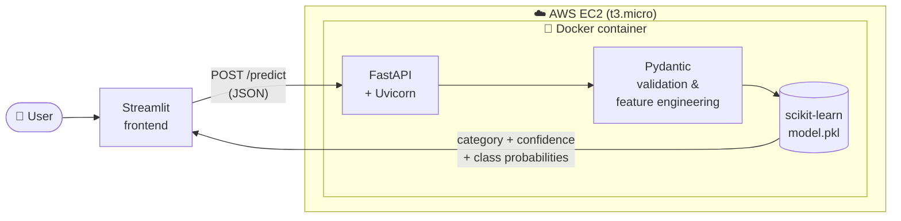
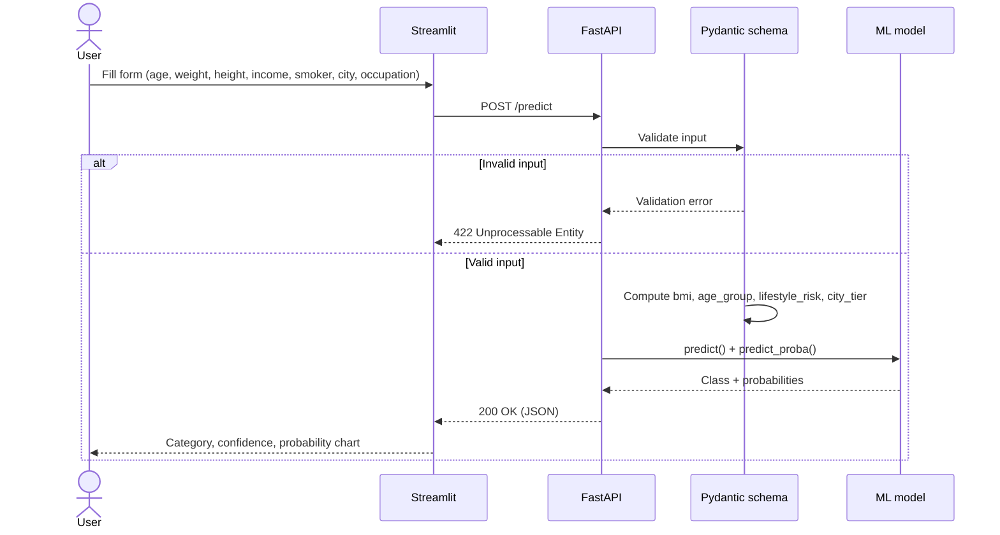
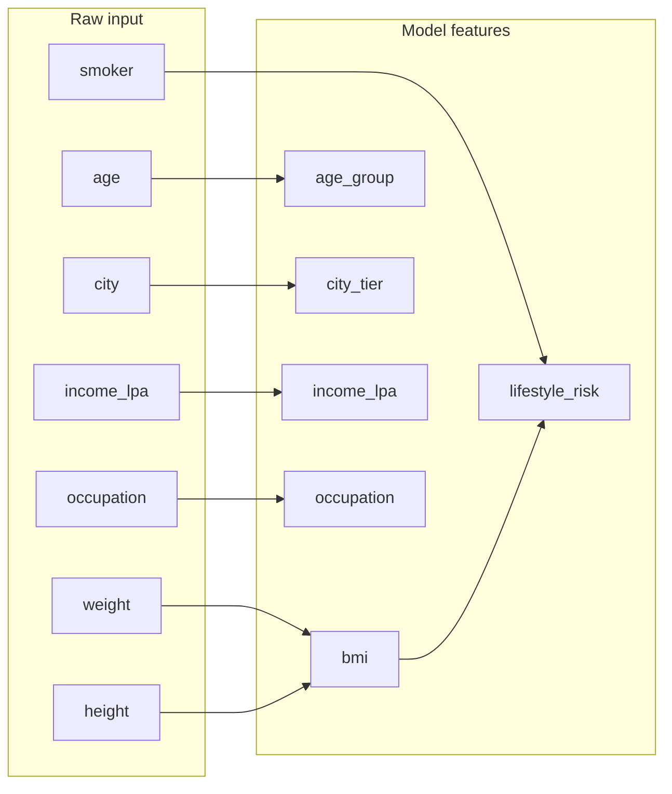
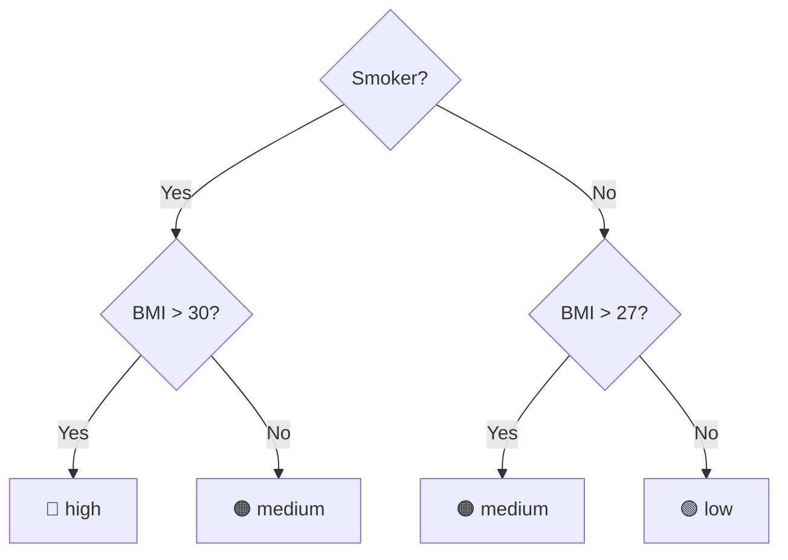
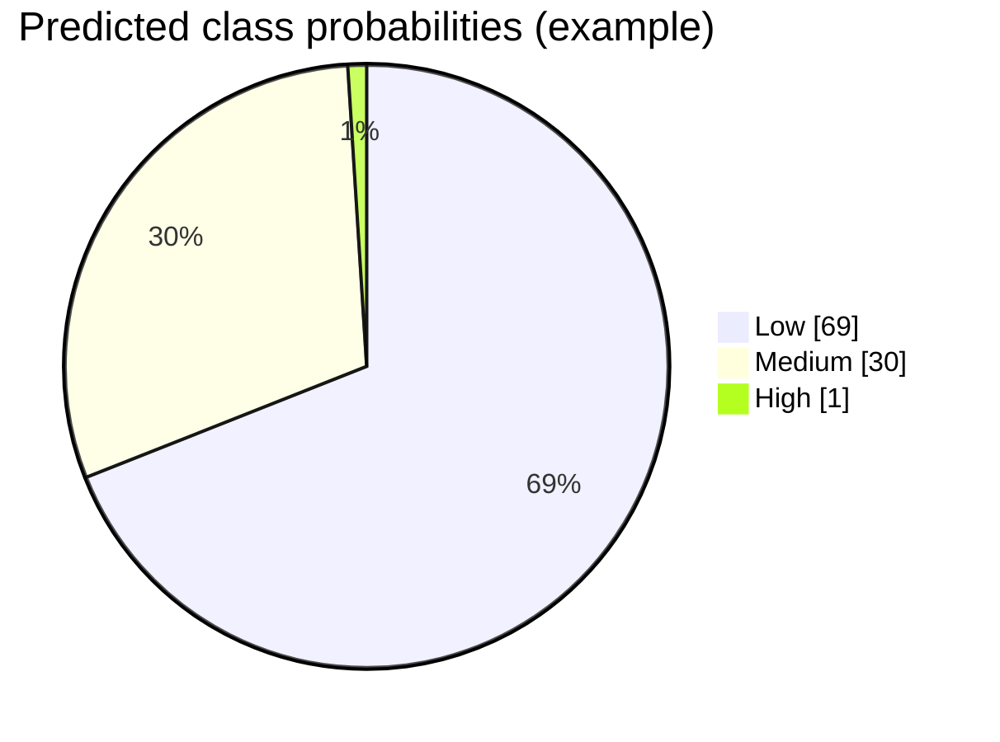
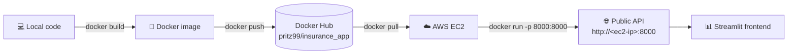

# 🏥 Insurance Premium Category Predictor


A machine learning API that predicts a person's **insurance premium category** (`Low`, `Medium` or `High`) from basic personal details. The model is served with **FastAPI**, packaged with **Docker**, deployed on **AWS EC2**, and used through a **Streamlit** frontend.

---

## 📐 Architecture



## 🔄 Request flow



---

## 🧮 Feature engineering

The user sends **7 raw inputs**. The Pydantic schema turns them into the **6 features** the model was trained on:



| Feature | Rule |
|---|---|
| `bmi` | weight / height² |
| `age_group` | `young` < 25 ≤ `adult` < 45 ≤ `middle_aged` < 60 ≤ `senior` |
| `lifestyle_risk` | `high` if smoker **and** BMI > 30 · `medium` if smoker **or** BMI > 27 · else `low` |
| `city_tier` | `1` for metros (Mumbai, Delhi, Bangalore, …) · `2` for 48 tier 2 cities · else `3` |

### Lifestyle risk logic



---

## 🔌 API endpoints

| Method | Endpoint   | Description |
|--------|------------|-------------|
| `GET`  | `/`        | Welcome message |
| `GET`  | `/health`  | Status, model version, and whether the model loaded |
| `POST` | `/predict` | Predicts the premium category |

Interactive Swagger docs are available at **`/docs`** once the API is running.

### Example request

```bash
curl -X POST http://localhost:8000/predict \
  -H "Content-Type: application/json" \
  -d '{
    "age": 30,
    "weight": 70,
    "height": 1.75,
    "income_lpa": 10,
    "smoker": false,
    "city": "Pune",
    "occupation": "private_job"
  }'
```

### Example response

```json
{
  "predicted_catgeory": "Low",
  "confidence": 0.69,
  "class_proabilites": { "High": 0.01, "Low": 0.69, "Medium": 0.3 }
}
```

Class probabilities for this example:



`occupation` must be one of: `retired`, `freelancer`, `student`, `government_job`, `business_owner`, `unemployed`, `private_job`.

---

## 📁 Project structure

```
insurance_app/
├── app.py                     # FastAPI app and endpoints
├── frontend.py                # Streamlit UI
├── model/
│   ├── model.pkl              # trained scikit-learn pipeline
│   └── predict.py             # loads the model and runs predictions
├── schema/
│   ├── ResponseModel.py       # input schema + computed features
│   └── output_response.py     # response schema
├── config/
│   └── cities.py              # tier 1 / tier 2 city lists
├── Dockerfile
├── requirements.txt           # API dependencies (used by Docker)
└── requirements-frontend.txt  # Streamlit dependencies
```

---

## 🚀 Deployment pipeline



### 1. Run locally

```bash
python -m venv myenv
myenv\Scripts\activate          # Windows  (Linux/Mac: source myenv/bin/activate)
pip install -r requirements.txt

uvicorn app:app --reload
```

Open http://localhost:8000/docs.

### 2. Build and run with Docker

The Dockerfile installs packages from a local `wheels/` folder, so the build doesn't need internet access inside Docker. Create that folder first:

```bash
pip download -r requirements.txt --only-binary=:all: --python-version 3.13 \
  --platform manylinux_2_28_x86_64 --platform manylinux_2_17_x86_64 --platform manylinux2014_x86_64 \
  -d wheels
```

```bash
docker build -t pritz99/insurance_app .
docker run -p 8000:8000 pritz99/insurance_app
```

Or pull the ready-made image from Docker Hub:

```bash
docker pull pritz99/insurance_app
```

### 3. Deploy on AWS EC2

1. Launch an Ubuntu `t3.micro` instance (free tier) and allow inbound traffic on port `8000` in the security group.
2. SSH in and install Docker:
   ```bash
   sudo apt update && sudo apt install -y docker.io
   ```
3. Pull and run the image:
   ```bash
   sudo docker pull pritz99/insurance_app
   sudo docker run -d --restart always -p 8000:8000 pritz99/insurance_app
   ```
4. Open `http://<ec2-public-ip>:8000/docs`.

### 4. Streamlit frontend

```bash
pip install -r requirements-frontend.txt
streamlit run frontend.py
```

Enter the API address (for example `http://<ec2-public-ip>:8000`, **without** `/predict`) in the sidebar, fill in the form and click **Predict**. You can also set it with the `API_URL` environment variable.

---

## 🛠️ Tech stack

| Layer | Tools |
|---|---|
| Model | scikit-learn, pandas, NumPy |
| API | FastAPI, Pydantic, Uvicorn |
| Frontend | Streamlit |
| Container | Docker, Docker Hub |
| Cloud | AWS EC2 |
